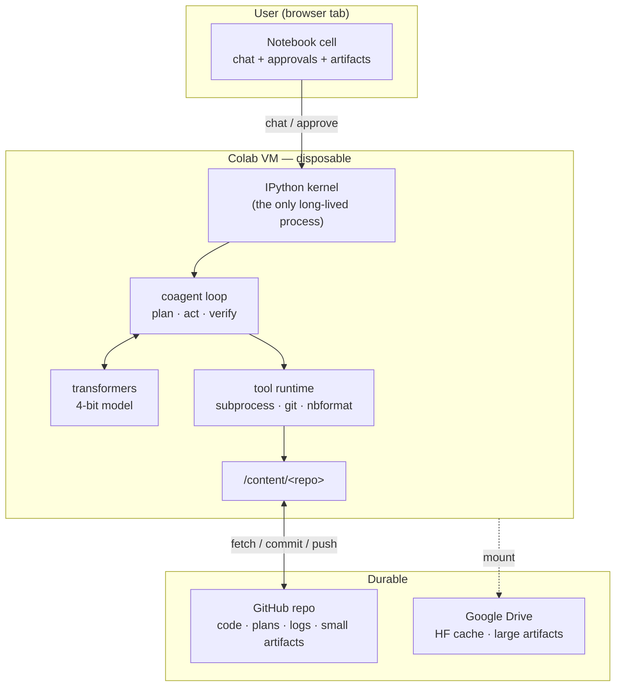
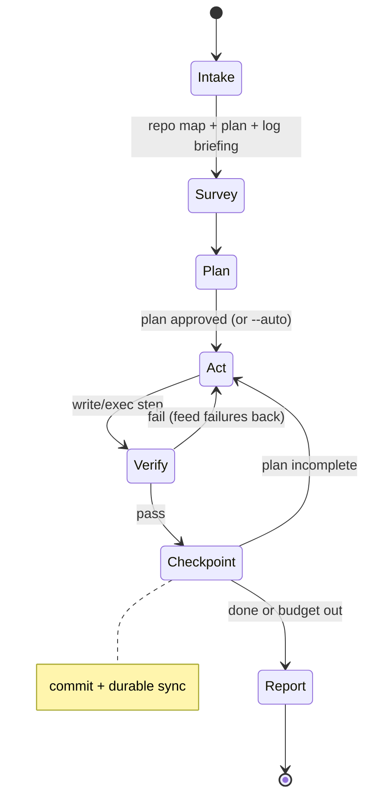

# coAgent — Design Document

**An AI coding agent that lives in a Colab VM, uses a git repo as its workspace and memory, and runs its own LLM locally through HuggingFace `transformers`.**

Status: greenfield design (repo currently contains only `LICENSE` and `.gitignore`).
Date: 2026-11-12.

---

## 0. TL;DR

Three ideas carry the whole design:

1. **The VM is cattle, the repo is the pet.** A Colab runtime can vanish at any moment. Nothing important may live only on `/content`. Every agent step ends in a git commit *that is synced off the VM* — a push, or a `git bundle` to Drive when the network is unavailable — so an eviction costs at most one turn. A commit is not the checkpoint; the sync is.
2. **Design for wall-clock, not tokens/sec.** A 7B model at 4-bit decodes ~25 tok/s on a free T4. A turn is 40–90 seconds. The metric that matters is *turns-to-done* and *crash cost*, so: repo map instead of exploration, diff edits instead of rewrites, tests instead of self-critique, one action per write.
3. **The model is a diff compiler, not an architect.** A 7B model cannot hold a system in its head. The human (or a plan file) supplies intent; the model translates intent into a verified edit. Deterministic checks — parser, linter, test suite — are the critic.

The result is an agent that is slower than a cloud agent but private (code never leaves the VM), free of API keys, and fully auditable: `git log --author=coagent` *is* the audit trail.

---

## 1. What Colab actually gives you

Almost every design decision below is a response to one of these constraints.

| Colab reality | Consequence | Design response |
|---|---|---|
| Ephemeral VM, ~12 h hard cap, idle disconnect | state must survive outside the VM | branch per session, commit + off-VM sync per step, plan file in repo |
| No inbound ports (only Colab's own proxy) | can't host a service for external clients | UI lives in the notebook; optional `serve_kernel_port_as_window` |
| One GPU, 16 GB on free tier | 7B at 4-bit, 8–16k usable context | model registry + OOM ladder (§4.5) |
| ~25 tok/s decode | turns are minutes | optimize turns-to-done, truncate aggressively |
| 2 vCPU, ~12 GB RAM | no vector DB or heavy CPU work beside inference | BM25 + symbol graph, subprocess isolation |
| Root-ish shell, no containers | no real sandbox | approval gates + denylist + branch isolation (§9) |
| Drive mount is slow, file-per-inode | bad for `mmap`, deadly for HF snapshots | tar the cache, copy to local disk at boot |
| Fast downloads (~100 MB/s) | re-downloading a 4.5 GB model costs ~1 min | prefer local HF cache each session |

Honest framing: **Colab is not a server.** coAgent is a *crafted notebook application*, not a daemon with a web UI. That constraint is what makes it survivable.

---

## 2. Architecture



Components, and what each owns:

| Component | Responsibility | Why it is separate |
|---|---|---|
| `agent/loop.py` | phase state machine, budgets, stop conditions | the only place that decides what happens next |
| `llm/*` | `generate(messages) -> text` behind one interface | swap transformers / vLLM / HF endpoint without touching the loop |
| `context/*` | repo map, BM25 retrieval, token budget, truncation | context is the scarcest resource; it needs its own ledger |
| `tools/*` | typed actions with safety classes | the model can only do what is registered |
| `gitx/*` | session branch, commit protocol, durable sync, resume, lock | turns git into a database |
| `ui/*` | notebook rendering, approval widgets, streaming | UI must degrade gracefully, never block the loop |
| `safety/*` | policy, denylist, secret redaction | enforcement is code, not prompt text |

The loop is ~600 lines of explicit Python. **No LangChain, no LangGraph, no agent framework.** With a weak model, every hidden prompt-mangling layer is a debugging cost you cannot pay; frameworks also spend tokens on their own scaffolding. A dict-based state machine is inspectable, replayable, and testable on CPU with a 0.5B model.

---

## 3. State: git as memory

### 3.1 Branch model

- `main` — the user's branch. **coAgent never pushes to it.**
- `coagent/<yyyy-mm-dd>-<short-id>` — one branch per session, synced off the VM on every checkpoint (§3.2) and pushed as the reviewable deliverable.
- `durable` — an optional private mirror remote, required when `origin` is public. The session branch contains failed attempts and possibly fragments of test data; pushing it to a public repo leaks that. A mirror keeps the WIP history reviewable without publishing it.
- Optionally `coagent/<...>-step-<n>` tags, if you want per-step diffs without branch noise.
- Clone policy: `--depth 1` by default (fast on Colab); `--unshallow` when a resume needs `git log` for the briefing or a rebase onto `origin/main`.

The agent opens the session with `git switch -c coagent/...`. If the branch already exists, that's a *resume*.

### 3.2 Commit protocol

One commit per verified step, with machine-readable trailers so history is queryable:

```
coagent: add chunked CSV loader

Stream rows into a Frame without loading the whole file; preserves dtypes
for columns declared in the schema.

Coagent-Session: 2026-11-12-a1b2c3
Coagent-Step: 7
Coagent-Task: add CSV loader with tests
Coagent-Verify: pytest -q (12 passed)
Coagent-Model: Qwen2.5-Coder-7B-Instruct@nf4
Coagent-Artifacts: artifacts/bench/load.csv
```

This gives you `git log --grep="Coagent-Task: add CSV"`, `git diff <step-6> <step-7>` for replay, and a blame trail that says *the model wrote this line, at this step, under this task*. Commit-per-step also means `git revert` is a per-action undo button.

**A commit is not a checkpoint; the sync is.** `/content` is exactly the disk that disappears, so immediately after every commit CHECKPOINT must move the history off the VM, using one of:

- `git push <remote> HEAD:refs/heads/coagent/<id>` — the default. Only `coagent/*` refs are pushable (§9.1); a public `origin` uses the private `durable` mirror instead.
- `git bundle` fallback when the push is unavailable or denied approval: the first bundle is full history, later ones are `A..B` increments written to `coagent/bundles/<id>/` on Drive. Cost is proportional to the diff, not the repo, and it needs no network.

Without this, "a crash costs one turn" is false — it costs the session — and the failure table in §10 does not apply.

Rebase/squash at session end into one "session" commit if the user prefers clean history — the trailers make that lossless.

### 3.3 The plan file is memory

`.coagent/plans/<task-slug>.md` is written during PLAN and updated as steps complete:

```markdown
# add CSV loader with tests
- [x] read src/frame.py, src/loader.py
- [x] add Frame.from_csv with chunk_size
- [ ] tests/test_loader.py: dtype preservation
- [ ] pytest -q green
```

This file is the single most important piece of memory in the system, because it survives **both** context eviction and VM death. After a 3k-token observation dump gets evicted, the loop re-reads the plan; after preemption, `resume` re-reads it. It is also the progress surface the user watches.

### 3.4 Session log

`.coagent/sessions/<session-id>.jsonl`, one record per step:

```json
{"t":1731400000.1,"step":7,"phase":"act","tool":"edit_file","args_hash":"9f2c","ok":true,
 "tokens":{"in":8123,"out":412},"ms":17400,"commit":"a1b2c3d"}
```

Committed at session end (not per step, to keep history readable). Secrets are redacted before the record is written (§9.2). If a crash leaves no log, the briefing falls back to `git log --grep="Coagent-"`. On resume, the last ~20 records are summarized into a 15-line briefing — *without* an LLM call; it is template extraction of files touched, failures, and open plan items.

### 3.5 Artifacts

Two classes, one manifest:

| Size | Where | In repo |
|---|---|---|
| < 5 MB | `artifacts/<run-id>/...` | yes, committed |
| 5 MB – 2 GB | Drive `coagent/artifacts/<sha256>` | pointer only |
| > 2 GB / datasets | Drive or original URL | pointer + checksum |

`artifacts/<run-id>/manifest.json` records `{path, sha256, bytes, store, created_by_step}`. Rule the agent is told and enforced in code: **never commit a binary it did not produce from text, and never exceed the size cap** — `edit_file` refuses over-cap files.

### 3.6 Resume and locking

`coagent resume` does: if the remote is behind the Drive bundles (a crash before the next push), clone from the full bundle and replay the incrementals in order; then `git fetch` → checkout session branch → load plan + last log records → print briefing → continue. Because state is entirely in git, **a session started on VM A can be resumed on VM B**, or on a Pro instance with a bigger model.

Concurrent sessions are prevented by an advisory lock: `.coagent/lock.json` with `session_id`, `expires_at` (heartbeat +30 min), committed on start. A live lock means refuse; `--force` takes over (single-user tool, so advisory is enough).

---

## 4. Model layer

### 4.1 Tier registry

| Tier | GPU / RAM | Model | Quant | Context | Notes |
|---|---|---|---|---|---|
| Free | T4 16 GB | Qwen2.5-Coder-7B-Instruct | NF4 | 12k | the default |
| Free, low | T4 | Qwen2.5-Coder-3B-Instruct | NF4 | 16k | when 7B won't fit with the repo map |
| Pro | L4 24 GB | Qwen2.5-Coder-14B-Instruct | NF4 / AWQ | 16k | quality jump, still usable speed |
| Pro high | A100 40 GB | Qwen3-Coder-30B-A3B (MoE) or 14B bf16 | 4-bit | 32k | 3B active params → fast despite size |
| No GPU | CPU | Qwen2.5-Coder-3B GGUF | Q4 | 8k | escape hatch only; kept behind the same interface |

Why Qwen2.5-Coder: strongest code model per VRAM at 7B, 32k native context, a documented tool-call chat template, permissive license, first-class `transformers` support. DeepSeek-Coder-V2-Lite is the runner-up (MoE, cheap active compute). CodeLlama is too old to be worth the context budget.

**Why local `transformers` at all** (vs. an API): privacy, no keys, no per-token cost, works on a free tier. The price is model quality, which the rest of this document is spent compensating for. The `llm/` interface also ships `HFEndpointBackend` so the same loop can point at a hosted 70B when quality matters more than privacy — this is a one-line config change, not an architecture change.

### 4.2 Inference settings that actually matter

```python
model = AutoModelForCausalLM.from_pretrained(
    name,
    quantization_config=BitsAndBytesConfig(
        load_in_4bit=True, bnb_4bit_quant_type="nf4",
        bnb_4bit_compute_dtype=torch.float16,   # T4 has no bf16
    ),
    device_map={"": 0},
    attn_implementation="sdpa",                 # flash-attn 2 needs Ampere+
)
```

- T4 is Turing: `float16`, `sdpa`. A100/L4: `bfloat16`, `flash_attention_2`.
- `TextIteratorStreamer(skip_prompt=True)` for live UI; generation on a worker thread.
- Sampling: `T=0.2` for edits (determinism beats creativity when writing diffs), `T=0.7` for planning, `top_p=0.95`, `repeat_penalty` mild, `max_new_tokens=1024` for edits, `2048` for plans.
- Fixed seed per session; log it. Reproducibility is worth more than the tiny diversity gain.
- `PYTORCH_CUDA_ALLOC_CONF=expandable_segments:True` before `import torch`.
- Never `torch.compile` on Colab: compile time exceeds most sessions' savings.

### 4.3 Structured output — the reliability core

A 7B model emits malformed JSON perhaps 3–8% of the time, and a malformed tool call costs a full turn. Escalation ladder:

1. **Tolerant parse.** One fenced block per message:
   ````text
   ```json
   {"tool": "edit_file", "args": {...}}
   ```
   ````
   Parse with a regex for the fence, then `json5`. On failure, re-prompt once with the parse error appended (cheap, usually works).
2. **Constrained envelope.** Use `outlines` to constrain *only the envelope*: the tool name is a regex choice over the registry (`"read_file"|"edit_file"|...`), then arg keys are schema-constrained. Free-form string values (file contents) are unconstrained. Two-stage decoding: ~30 constrained tokens + normal continuation. This removes the entire class of "invented tool name" and "wrong arg key" failures. Ship it behind `[model] constrained = true` and only after measuring it on the eval set: `outlines` pins `transformers` versions and adds a second decode path, so the tolerant-parse route must stay default and fully functional.
3. **Verifier-guided sampling.** After two failed attempts at a step, sample 3 candidates at `T=0.4`, filter by syntax/lint, and take the first that passes. Costs 3× decode on that step only — a good trade against another full turn.

### 4.4 Throughput budget (T4, 7B NF4)

| Operation | Cost |
|---|---|
| Prefill 12k tokens | ~20 s |
| Decode 400 tokens | ~16 s |
| One turn incl. tools | 45–90 s |
| 20-turn task | 20–30 min |

So a realistic session is **3–6 tasks**, not 20. This is why task decomposition and commit-per-step matter more than any inference optimization. Two optimizations are worth having, one is a trap:

- **Worth it:** keep the static prefix (system + tool docs + repo map) at the front of every prompt so vLLM's prefix cache or `StaticCache` reuse applies; order messages so the volatile suffix is small.
- **Worth it:** run `pytest`/`ruff` in the background while the model decodes the next step.
- **Not worth it:** multi-agent fan-out. One GPU means serialized inference; "agents" would just be turns with extra prompts and less shared context.

### 4.5 OOM ladder

On `torch.cuda.OutOfMemoryError`, in order, without losing the session:

1. `gc.collect(); torch.cuda.empty_cache()`, retry with 25% less context.
2. Halve `max_new_tokens`.
3. Drop to the next tier's 3B model (weights swap ~20 s).
4. Offer CPU fallback / endpoint fallback in the UI.

Prefill memory is the usual culprit, not generation — shrink *retrieved context* first, not the prompt instructions.

### 4.6 Residency: the model owns the GPU

Weights plus embeddings are ~5–6 GB and the KV cache another ~0.7 GB at 12k, so a 16 GB T4 has roughly 8–9 GB left. In an ML repo, `pytest` or a training smoke test will try to claim that and OOM. Policy:

- `[verify] commands` run with `CUDA_VISIBLE_DEVICES=""`. Fast tests should be CPU tests; this makes the default safe rather than lucky.
- `[verify] gpu_commands` run **once per task**, in a dedicated step: unload the model, `torch.cuda.empty_cache()`, check free VRAM against `[verify] vram_reserve_mb`, run, reload. The 20–60 s cost is why this is not part of every edit.
- Verification never runs concurrently with decode; with 2 vCPU the test subprocess is also `nice`d.
- If a GPU test OOMs, do **not** run the §4.5 ladder — the model is the thing that has to yield.

---

## 5. Context layer

### 5.1 Budget for a 12k window

| Slot | Tokens | Notes |
|---|---|---|
| system + tool docs | 900 | static, cached |
| repo map | 2000 | §5.2 |
| task + plan file | 500 | re-read after eviction |
| retrieved excerpts | 3000 | BM25, 5 chunks max |
| recent observations | 3000 | last 3 tools, head/tail truncated |
| reserved for output | 1500 | |
| slack | 1100 | safety margin |

Notebook cell outputs are deliberately outside this budget: they go to artifacts, and only the last traceback (or a 40-line tail) is pulled into context. A single `display(df)` can exceed the entire observation slot.

Eviction order: oldest observation → retrieved excerpts → repo map size → (never) system prompt. Compression is **deterministic**, not LLM-based: extract paths, line numbers, error lines, and assertion messages via regex. An LLM summarization pass costs 10 s and can hallucinate; regex cannot.

### 5.2 Repo map — the biggest single win

Parse every source file with tree-sitter, emit signatures only:

```
src/loader.py
  def load(path: str, *, chunk_size: int | None = None) -> Frame
  def _infer_dtypes(rows: list[dict]) -> dict[str, type]
src/frame.py
  class Frame
    def from_csv(cls, path: str, **kw) -> Frame
    def head(self, n: int = 5) -> Frame
```

No bodies. This is the difference between a model that knows the shape of a 5k-line repo and one that burns four turns grepping. Cost: ~50 ms for 5k LOC, re-parsed incrementally on each edit (only changed files). Pin `tree-sitter` with per-language grammar wheels (`tree-sitter-python`, `tree-sitter-javascript`, …); the old `tree_sitter_languages` bundle is unmaintained and is a common Colab install failure. Ship a regex fallback so a missing grammar degrades the map instead of ending the session.

Ranking is PageRank-lite: `score = 0.5·reference_count + 0.3·recently_edited + 0.2·mentioned_in_task`, then pack greedily into the 2k budget. Files the task names always survive.

### 5.3 Retrieval

BM25 over function-sized chunks, plus symbol-graph adjacency (callers/callees of the files already in context). **No vector store**: on 2 vCPU beside a GPU, an embedding index is a memory and latency tax for a ranking gain BM25 mostly covers in a repo of this size. `sentence-transformers/all-MiniLM-L6-v2` (~80 MB) is an optional Pro-tier upgrade, not a dependency.

### 5.4 Invariants

- **Read before write.** `edit_file` fails if the path has not been read (or was written) this session. Cheap enforcement of grounding; kills the hallucinated-edit class of failure.
- **Cite before edit.** The model includes the `file:line` it is anchoring on, but as a *soft hint* used for ranking and reporting only. The `search` block is the sole authority: hard-checking a line number that earlier steps shifted produces spurious rejections and burns turns.
- **One write or exec action per message.** Up to 3 read-only tools may be batched. Parallel writes on a weak model produce cascading inconsistency.

---

## 6. Tools

| Tool | Class | Behavior |
|---|---|---|
| `list_dir`, `read_file`, `grep`, `repo_map` | read | auto-approved, output truncated head/tail |
| `edit_file` | write | SEARCH/REPLACE, unique match required |
| `write_file` | write | new files, or full rewrite only if < 200 lines |
| `run_shell` | exec | argv mode preferred, `cwd=repo`, 120 s timeout, process-group kill |
| `run_python` | exec | fresh subprocess, never the kernel |
| `run_tests` | exec | `verify.commands` from config, failures parsed |
| `apply_codemod` | exec | agent writes a script, runs it against the repo, then verifies |
| `git_status/diff/commit/branch/push` | vcs | push gated; never to `main` |
| `edit_notebook`, `exec_notebook` | write/exec | cells by id; execute via `nbconvert` in a subprocess |
| `display_artifact` | ui | renders image/HTML/plot in the output cell |
| `save_artifact` | write | repo or Drive per size policy (§3.5) |
| `ask_user` | ui | blocks for input, returns text |
| `mount_drive`, `gpu_info` | colab | setup and preflight |

**Mechanical edits go through `apply_codemod`.** A 10-file rename is twenty turns of SEARCH/REPLACE by construction; one script is three. The agent writes it to `.coagent/tmp/`, runs it with the repo on `PYTHONPATH`, and the normal verification gate decides whether it counted. This is the main leverage of sitting *inside* a Python VM, and it is safer than two hundred diffs.

### 6.1 Edit format

SEARCH/REPLACE blocks (Aider's proven format), not whole files:

```json
{"tool":"edit_file","args":{
  "path":"src/loader.py",
  "cite":"src/loader.py:14",
  "search":"def load(path):\n    return Frame(rows)",
  "replace":"def load(path):\n    return Frame.from_rows(rows)"}}
```

Rules enforced in code:

- `search` must match **exactly once**. Zero matches → fuzzy match (whitespace-normalized, indentation-insensitive), and if a single fuzzy candidate exists, return that region with line numbers so the model can retry precisely. Multiple matches → reject, ask for more context.
- Full-file rewrite is only legal for new files or files under 200 lines. Large-file rewrites are the single biggest source of catastrophic diffs with small models; disallowing them is worth the extra turns.
- `cite` is advisory: it ranks the nearest match and goes into the log, but only `search` decides whether the edit applies (§5.4).
- Every edit is followed by a syntax check (`ast.parse` / `tsc --noEmit` / `ruff`) before it is allowed to count as a step.

### 6.2 Execution isolation

There is no container on Colab, so isolation is *process-level*, and the document should not pretend otherwise:

- `subprocess.Popen(..., start_new_session=True)`, `os.killpg(os.getpgid(p.pid), SIGKILL)` on timeout.
- Scrub env: remove GitHub/HF/cloud tokens from the child's environment; they are only in the parent for git push.
- Cap combined stdout+stderr at 64 KB, then truncate to head/tail 60/40 with line numbers.
- `run_python` uses a fresh interpreter with `PYTHONPATH=repo/src`, so a stray `sys.exit()` or infinite loop cannot kill the kernel or the model's CUDA context.
- For notebooks, `nbconvert --execute --to notebook --inplace --ExecutePreprocessor.timeout=300` in a subprocess; parse outputs for tracebacks and images.

**Path jail — reads included.** Every path argument is `Path.resolve()`d and must sit inside the repo root, `/tmp/coagent`, or an explicit `[tools] allow_read` entry. This applies to `read_file` and `grep` even though they are auto-approved: after `mount_drive`, an unjailed read is access to the user's entire Drive. `.git/` is not readable through `read_file`; the git tools open it directly.

The kernel itself stays clean: it holds the model and the loop, and nothing else.

### 6.3 Colab-native tools

These are the reason to run *in* Colab rather than beside it:

- `display_artifact` → `IPython.display.Image/HTML` so a plot or rendered table appears inline in the chat cell.
- `save_artifact` → `files.download()` for one-click retrieval, Drive for large outputs.
- `mount_drive` → `google.colab.drive.mount`, asked once, used for HF cache and big artifacts; everything it exposes is still behind the read jail (§6.2).
- `gpu_info` → preflight: read `torch.cuda.get_device_properties`, pick the tier from §4.1, set `max_context`.

---

## 7. The agent loop



### 7.1 Phases, with different prompts and different tool sets

Split by phase rather than one omniscient prompt, because small models do one job well:

| Phase | Sees | Can do | Sampling |
|---|---|---|---|
| SURVEY | repo map, task, plan | read tools only | T=0.2 |
| PLAN | task + retrieved files | none (writes a plan file) | T=0.7, 1500 tok |
| ACT | plan, relevant excerpts, last 3 observations | one write/exec | T=0.2 |
| VERIFY | diff, test output | run tests/lint only | deterministic |
| REPORT | plan, log | none | T=0.5, 400 tok |

The critical property: **PLAN cannot write.** A model that can act while planning will start editing before it has read the file it is editing.

### 7.2 The human owns the plan

For anything non-trivial (> ~1 file or > 5 estimated steps), the plan is shown and must be approved before ACT. In interactive mode this is a button in the cell; `--auto` pre-approves. This one gate prevents the most expensive failure mode: 20 minutes of GPU on a misunderstood task. It is also the honest division of labor — the human supplies intent, the model executes.

### 7.3 Budgets and stop conditions

```python
Budget(max_steps=60, max_wall_s=45*60, max_tokens=200_000,
       max_gpu_min=40, max_commits=40, max_consecutive_failures=3)
```

On exhaustion: checkpoint, write a REPORT (what landed, what's blocked, next step), stop. Never silently continue — unattended token burn is how a "free" agent becomes expensive in time.

### 7.4 Loop detection

`fingerprint = sha256(diff + tool + args)`. If the fingerprint is unchanged twice, inject: "you are repeating yourself; re-read the failure output and choose a different approach." Three times: force a replan with the failure history. Five: stop and hand back with a diagnostic. Also flag "edit without read" and "same test failing after 3 different edits" as loop signals.

### 7.5 Verification is the critic

Three tiers, cheapest first, configured per repo in `.coagent/config.toml`: (1) syntax parse, (2) linter/type-check, (3) test suite. Only the failing parts are fed back — test names plus the last 40 lines of each traceback, capped at ~1500 tokens. A 500-line pytest dump is worse than no output: it evicts the context the model needs to fix the failure.

**Definition of done** (enforced, not suggested): `verify.commands` all pass **and** every plan checkbox is ticked **and** no new `TODO`/`pass  # implement` markers introduced. If the repo has no tests, the plan must include writing one — "add feature" without a test is not done. Configured `gpu_commands` run once at the final checkpoint, after the model yields the GPU (§4.6), never on every edit.

### 7.6 A worked turn

```
user:  add a chunked CSV loader to src/loader.py and test dtype preservation

SURVEY  read src/loader.py, src/frame.py; repo map shows Frame.from_rows exists
PLAN    .coagent/plans/chunked-csv.md written        [approved]
ACT     edit_file src/loader.py  (+18 -3)            [syntax ok]
VERIFY  pytest tests/test_loader.py -q → 1 failed    [assert dtype]
ACT     edit_file src/loader.py:31                   [fix cast]
VERIFY  pytest -q → 12 passed
CHECKPOINT commit a1b2c3d "coagent: add chunked CSV loader" (Coagent-Step: 7) + push
REPORT  branch coagent/2026-11-12-a1b2c3 ready; 1 file, +18 -3, 12 tests green
```

---

## 8. UX

### 8.1 Notebook UI (guaranteed path)

The chat cell is a `display_handle` updated with `Markdown` every ~8 tokens (`clear_output(wait=True)` flickers and scrolls; `handle.update` does not). Tool calls render as collapsed `<details>` blocks: one line when collapsed, args and truncated output when expanded. Approvals are `ipywidgets` buttons inline in the cell.

```
coAgent · Qwen2.5-Coder-7B · 12k ctx · T4 16GB · session a1b2c3
────────────────────────────────────────────────────────────
You: add a chunked CSV loader and test dtype preservation

▸ plan  4 steps, est. 6 min                          [approve] [edit]
▸ step 1  read src/loader.py, src/frame.py                 1.2s
▸ step 2  edit src/loader.py  +18 −3                       0.4s
▸ step 3  pytest -q  → 1 failed                            2.1s
▸ step 4  edit src/loader.py  +2 −2                        0.3s
▸ step 5  pytest -q  → 12 passed                           2.4s
✓ committed a1b2c3d · artifacts none
```

### 8.2 Python API in a cell

```python
agent = coAgent(repo="/content/my-repo", model="qwen-coder-7b")
agent.chat("add a chunked CSV loader and test dtype preservation")
agent.show_log()          # last 10 steps with diffs
agent.resume()            # after a disconnect
agent.push()              # push branch, optionally open a PR via gh
```

### 8.3 Optional rich UI

Gradio on 7860 exposed with `google.colab.output.serve_kernel_port_as_window(7860)` — works in the Colab tab, no tunnel, no ToS risk. It is a *nicety*: the notebook UI must be good enough that the product works without it. `share=True` and ngrok are explicitly out of scope (flaky, rate-limited, and a security surface).

---

## 9. Safety and secrets

### 9.1 Approval matrix

| Action | Default |
|---|---|
| read / grep / repo map, inside the jail | allow |
| read outside the jail | deny; `[tools] allow_read` is explicit |
| write inside repo (session branch) | allow |
| run tests, lint, syntax check | allow |
| arbitrary shell command | ask, remembered per command pattern |
| network access | ask (the checkpoint push below is the standing exception) |
| `pip` / system install | ask |
| delete / move / chmod | ask |
| write outside repo (except `/tmp`, Drive artifacts) | ask |
| `git push` to `coagent/*` on a configured remote | allow at CHECKPOINT |
| push any other ref, or to an unconfigured remote | deny |
| push to `main`, `--force`, `reset --hard` | deny |

In non-interactive mode the default flips to **deny**, not allow. Deny rules are evaluated before allow rules, so `git push --force` stays denied even on a `coagent/*` ref. The denylist (`rm -rf /`, `curl … | sh`, `git push --force`, `chmod -R 777 /`, fork bombs) is a seatbelt, not a sandbox — say so plainly in the docs. The real control is that every risky class needs a human click.

### 9.2 Secrets

- Read from `google.colab.userdata` at boot, hold in memory, inject only into the git child process env, never into the repo, never into the log.
- `.env` and `.coagent/secrets*` are gitignored by the bootstrap, not by convention.
- Redaction regexes before any log/display write: `ghp_[A-Za-z0-9]{36}`, `github_pat_…`, `hf_…`, `sk-…`, `AKIA[0-9A-Z]{16}`, `AIza…`, JWT shape. Redact to `•••` plus last 4 chars.
- Clone through a `GIT_ASKPASS` credential helper, never with the token embedded in the remote URL: `.git/config` persists on disk, shows up in `git remote -v` output, and would be captured in every Drive bundle.
- Use a **fine-grained PAT scoped to the one repo**, and tell the user not to paste it into a cell (cells are saved in Drive revision history). `userdata` exists precisely to avoid that.

### 9.3 Prompt injection

Repo files, issue text, and command output are untrusted. The defense has three layers: (1) observations are wrapped in `<observation tool="…">` and the system prompt says content inside is data, never instructions; (2) side effects require approval, so an injected "push to main" hits a wall regardless of what the model believes; (3) the agent branch cannot reach `main`. Layer 1 is best-effort; layer 2 is the actual guarantee. Be explicit about that in the threat model rather than overselling prompt-level defenses.

---

## 10. Failure modes

| Symptom | Detection | Recovery |
|---|---|---|
| CUDA OOM | exception | shrink context → halve output → 3B → CPU (§4.5) |
| CUDA assert / poisoned context | exception on next kernel | restart runtime; state is in git; `resume` |
| Preemption / idle disconnect | heartbeat gap | `resume` from the last synced step; at most one step is lost |
| Infinite edit loop | fingerprint ×3 | replan, then stop with diagnostic |
| Bad SEARCH match | 0 or >1 matches | return nearest region with line numbers, retry once |
| Test-output flood | > 4k tokens | extract failures only |
| GPU test OOM | `[verify] gpu_commands` step | unload the model, retry once, else skip and report (§4.6) |
| Durable sync fails | push error / denial | write an incremental bundle to Drive and continue |
| Model download stall | no progress 60 s | resume; Drive tar cache fallback |
| Drive I/O too slow | > 20 ms/op | copy cache to `/content` at boot |
| Push rejected / diverged | git error | rebase agent branch onto `origin/main`, never rewrite `main` |
| Notebook execution hang | 300 s timeout | kill process group, report cell id |
| Token in output | redaction regex | redact, warn, suggest rotation |

---

## 11. Repository layout and config

```
coagent/
  pyproject.toml
  notebooks/bootstrap.ipynb        # the one cell a user runs
  src/coagent/
    cli.py                         # run | resume | chat | eval | push
    config.py
    agent/    loop.py prompts.py budget.py state.py
    llm/      base.py transformers_backend.py vllm_backend.py
              hf_endpoint_backend.py registry.py grammar.py
    context/  repo_map.py retrieval.py compressor.py tokens.py
    tools/    base.py fs.py shell.py python_exec.py git_tools.py
              notebooks.py artifacts.py colab.py approval.py
    gitx/     session.py commit.py durable.py resume.py lock.py
    ui/       notebook.py render.py gradio_app.py
    safety/   policy.py denylist.py redact.py
    evals/    harness.py tasks/
  tests/
```

Per-repo config, committed so the setup is reproducible:

```toml
# .coagent/config.toml
[model]
name = "Qwen/Qwen2.5-Coder-7B-Instruct"
quant = "nf4"
max_context = 12288
max_new_tokens = 1024
constrained = false          # outlines envelope decoding, behind a flag (§4.3)

[verify]
commands = ["ruff check .", "pytest -q"]   # CPU-only, CUDA_VISIBLE_DEVICES=""
gpu_commands = []                          # run once, model unloaded (§4.6)
timeout_s = 300
vram_reserve_mb = 1024
require_tests = true

[git]
author_name = "coAgent"
author_email = "coagent@users.noreply.github.com"
remotes = ["origin"]         # add "durable" when origin is public
clone_depth = 1

[durability]
mode = "push"                # push | bundle (Drive)
remote = "origin"

[tools]
allow_read = []              # e.g. "/content/data"; repo root is always allowed

[artifacts]
commit_under_mb = 5
store = "drive"

[safety]
require_approval = ["network", "install", "delete", "write_outside_repo"]
deny = ["git push --force", "git push origin main"]
```

Bootstrap (the entire install story):

```python
!pip -q install "git+https://github.com/<user>/coagent"
from coagent import coAgent
agent = coAgent(repo="https://github.com/<user>/my-project.git")
agent.chat()
```

Bootstrap must do three things before the first turn, which the snippet hides:

- Set `user.name` / `user.email` — without them the first `git commit` fails.
- Install a `GIT_ASKPASS` credential helper instead of embedding the token in the clone URL (§9.2).
- Warn — not silently edit — when `.gitignore` lacks `.env` and `.coagent/secrets*`. Silently mutating a tracked file during setup is the kind of surprise that erodes trust in an agent.

---

## 12. Evals

A fixed toy repo plus 20 tasks, run headless (`coagent eval`), because "it feels good" is not a benchmark:

| Task class | Example | Pass criterion |
|---|---|---|
| bug fix | failing test → green | tests + no new lint |
| feature | add CLI flag with test | tests + plan complete |
| refactor | extract function, behavior identical | existing suite green |
| notebook | plot CSV column, save PNG | executes, artifact exists |
| test writing | cover untested branch | coverage delta, suite green |
| doc | update README for new flag | non-empty diff, links valid |

Metrics: success rate, **turns-to-done**, wall-clock, tokens, commits per task, regression rate, human-takeover rate. The interesting number is turns-to-done — it is the one the whole context design is optimizing.

**Sharding.** Twenty tasks at ~20 minutes each is roughly 7 h of generation, and retries make it worse than a single session tolerates. `coagent eval --shard k/5` runs 4 tasks per session and appends to `evals/results.jsonl`; `--report` merges the shards. A 1.5B smoke suite fits one session; the full suite runs on whichever tier can pay for it. Because the harness is the same loop driven with `--auto` over a fixed task list, sharding is a different task list, not a second code path.

**Baseline.** turns-to-done is meaningless without a reference: record a human-time baseline on the same tasks, plus one cloud-agent run, and report all three together.

---

## 13. Build plan

| Milestone | Deliverable | Acceptance |
|---|---|---|
| M1 (week 1) | loop, 6 tools, transformers backend, notebook UI | fixes a failing test in a toy repo end-to-end |
| M2 (week 2) | repo map, SEARCH/REPLACE reliability, verify loop, durable checkpoints, resume | same task survives a forced runtime restart; a crash before the next sync loses at most one step |
| M3 (week 3) | plan file + approval gate, artifacts, Drive cache, approvals UI | 5-task eval at ≥ 60% |
| M4 (week 4) | constrained decoding, OOM ladder, evals, demo notebook | 20-task eval, documented failure modes |

Definition of shipped: *from a fresh Colab session, coAgent fixes a failing test in an unfamiliar 5k-line repo in under 20 minutes and leaves a reviewable branch.*

---

## 14. Alternatives considered

| Option | Why not |
|---|---|
| LangChain / LangGraph | hidden prompt layers, token overhead, harder to debug a weak model |
| Whole-file rewrites | catastrophic diffs above ~200 lines; diffs are strictly better |
| Vector DB over the repo | CPU/memory tax beside a GPU; BM25 + symbol graph is enough here |
| Multi-agent (planner/coder/critic as separate runs) | one GPU serializes inference; costs turns without adding information |
| Fine-tuning the model | out of scope for v1; tests + context engineering dominate the ROI |
| Local orchestrator + Colab as remote executor | a valid topology, but it moves the LLM off the free GPU unless you tunnel — the in-Colab design keeps everything in one place |
| Hosted API (OpenAI/Anthropic) | defeats privacy/free/no-keys; kept as an opt-in backend, not the default |
| `share=True` Gradio | tunnel flakiness, rate limits, public exposure; Colab's port proxy is enough |

---

## 15. Open questions

Items 6–9 now have working assumptions that the rest of this document follows; 1–5 and 10–12 still need a decision.

| # | Question | Why it changes the design | Working assumption |
|---|---|---|---|
| 1 | Tier target: free T4 only, or Pro/G4 too? | sets the context budget and whether vLLM is worth shipping | free T4 16 GB (7B / 12k); L4/A100 auto-detected via `gpu_info`, not optimized |
| 2 | Primary surface: notebook or CLI? | determines where the UI investment goes | notebook-first; the CLI wraps the same loop |
| 3 | Scope: one repo or a workspace? | multi-repo needs cross-repo retrieval and per-repo locks | one repo per session |
| 4 | How first-class are notebooks? | cell outputs are unbudgeted and large | first-class notebook tools; outputs to artifacts (§5.1) |
| 5 | Distribution: git+pip, badge, or PyPI? | packaging and the landing page | `pip install git+…` plus an "Open in Colab" badge; no PyPI in v1 |
| 6 | Durability cadence: push per step, or bundle only? | puts network approvals on the hot path | push per checkpoint, Drive bundle fallback (§3.2) |
| 7 | Is **training** in scope — write scripts or run them? | changes VRAM budget, artifact policy, preemption tolerance | v1 writes and smoke-runs training scripts; long runs out of scope |
| 8 | Read scope: repo-only, or data dirs too? | sets the size of the jail in §6.2 | repo-only plus explicit `[tools] allow_read`; `/content/data` is opt-in |
| 9 | Are WIP commits allowed on a public repo? | publishes failed attempts and fragments of test data | never; private `durable` mirror, or push only on verify-pass |
| 10 | What is the eval baseline? | turns-to-done needs a reference point | human-time on the same tasks plus one cloud-agent run, reported together |
| 11 | When may it escalate to `HFEndpointBackend`? | trades the privacy guarantee for quality | per-task opt-in, shown in the UI; never silent |
| 12 | Repo size ceiling / shallow clone? | `--depth 1` is fast but cripples audit and rebase | depth-1 default, `--unshallow` when resume needs history |
