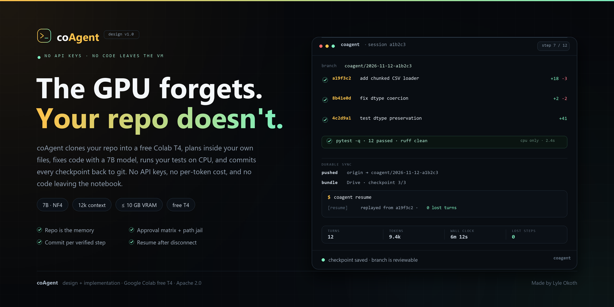
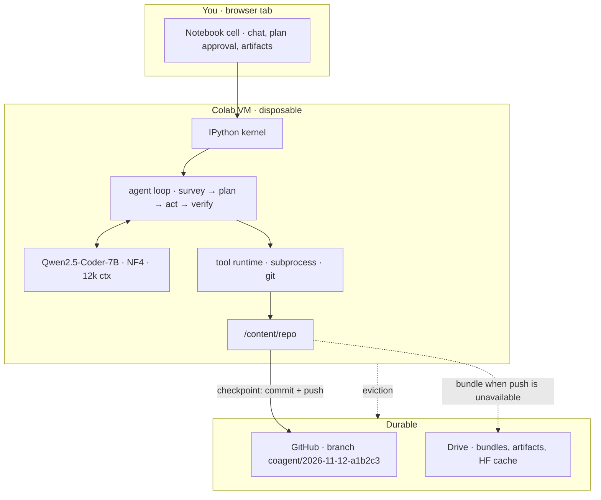

# coAgent

<p align="center">
  
</p>

<p align="center">
  
  
  
  
  <a href="https://github.com/lyle-mlengineer/coagent-web"></a>
  
</p>

**[Design](./DESIGN.md) · [PRD](./PRD.md) · [Web front door](https://github.com/lyle-mlengineer/coagent-web)**

> **Design stage.** This repository holds the full architecture (`DESIGN.md`) and product requirements (`PRD.md`); implementation starts at v0.1 in the build plan below. Every interface shown here — the cell, the commands, the config — is the target v0.1 surface, not a shipped package yet.

**coAgent is an AI coding agent that lives inside a Google Colab notebook.** It clones your repo into the free T4, plans inside your own files, edits with a locally loaded 7B model, runs your tests on CPU, and commits every checkpoint back to git — on a branch you can review. The runtime is disposable; the repository is the memory.

No API keys. No per-token cost. Nothing sent to a third-party model API — your code only travels to the repo you already own.

The public landing page, waitlist, and GitHub sign-in live in [coagent-web](https://github.com/lyle-mlengineer/coagent-web). This repo is the agent itself.

## What it does

**Cloud coding agents assume a credit card and that you will send them your code.** Colab gives students, researchers, and independent engineers a free GPU but none of the workflow: no durable disk, no inbound ports, and a runtime that disappears without warning. coAgent is designed backwards from that constraint.

- 🔒 **Private by construction** — the 7B model runs in your Colab VM. Your code is never sent to a third-party API, and there is no account beyond GitHub.
- 💸 **Zero keys, zero marginal cost** — 7B at NF4 fits the free T4 (4.2–4.6 GB of weights, ≤10 GB peak VRAM), so exploration is never metered.
- 🧠 **Git is the state store** — one commit per verified step, pushed or bundled off the VM before the next turn. A dead runtime costs at most one step.
- ✅ **Tests are the critic** — a 7B model cannot hold a system in its head, so deterministic checks decide what counts as done: parse, lint, then your suite.
- 🧯 **Honest about failure** — a VRAM OOM ladder, step/wall-clock/token budgets, loop detection, and a written report instead of a silent stop.
- 📓 **Notebook-native** — plots render inline, artifacts persist to the repo or Drive with a manifest, and the UI works without hosting anything.

## Who it's for

| If you are… | coAgent gives you… |
| --- | --- |
| **A solo ML engineer** *(primary)* | Repo changes and test runs without leaving Colab or paying per token — with your code staying private. |
| **A data analyst** | A cell edited, executed, and a figure rendered and saved with a manifest, not just source files. |
| **A student or learner** | A real coding agent at zero marginal cost, on hardware you already have. |
| **Not for:** teams needing concurrent users, monorepos over ~50k LOC, or fully autonomous long-running agents. | Those needs would compromise the T4-only, single-user design. |

## How it works



The loop is split into five phases with **different prompts and different tool sets**, because a small model does one job well:

| Phase | Sees | Can do | Sampling |
| --- | --- | --- | --- |
| **SURVEY** | repo map, task, plan | read tools only | T=0.2 |
| **PLAN** | task + retrieved files | nothing — writes a plan file | T=0.7 |
| **ACT** | plan, excerpts, last 3 observations | one write or exec | T=0.2 |
| **VERIFY** | diff, test output | run tests/lint only | deterministic |
| **REPORT** | plan, log | nothing | T=0.5 |

**PLAN cannot write.** A model that can act while planning will start editing before it has read the file. For anything beyond a single-file change, the plan is shown and must be approved before ACT — the human supplies intent, the model executes.

### A worked turn

```text
user:  add a chunked CSV loader to src/loader.py and test dtype preservation

SURVEY  read src/loader.py, src/frame.py; repo map shows Frame.from_rows exists
PLAN    .coagent/plans/chunked-csv.md written        [approved]
ACT     edit_file src/loader.py  (+18 -3)            [syntax ok]
VERIFY  pytest tests/test_loader.py -q → 1 failed    [assert dtype]
ACT     edit_file src/loader.py:31                   [fix cast]
VERIFY  pytest -q → 12 passed
CHECKPOINT commit a1b2c3d "coagent: add chunked CSV loader" (Coagent-Step: 7) + push
REPORT  branch coagent/2026-11-12-a1b2c3 ready; 1 file, +18 -3, 12 tests green
```

## Designed backwards from a free T4

Every design decision is a response to a Colab constraint.

| Colab reality | What coAgent does about it |
| --- | --- |
| **Ephemeral VM**, ~12 h cap, ~90 min idle disconnect | Commit per verified step, sync off the VM before the next turn, and resume from the last checkpoint on any new VM. |
| **One free T4**, 16 GB, compute capability 7.5 | 7B at NF4, 12,288-token hard cap, fp16 + SDPA. Model resident ~6.5–8 GB, leaving ≥7 GB for your own work. |
| **~25 tokens/s decode** | Repo map instead of exploration, diffs instead of rewrites, tests instead of self-critique. Turns-to-done is the metric. |
| **2 vCPU, ~12.7 GB RAM** | No vector database. BM25 over function-sized chunks plus a symbol graph. |
| **No inbound ports** | The UI lives in the notebook; no daemon, no tunnel, no hosted service. |
| **Root-ish shell, no containers** | Approval matrix, command denylist, path jail on reads *and* writes. The denylist is a seatbelt, not a sandbox — the real control is the human click. |

Preflight prints the GPU, VRAM, RAM, cache state, and chosen context budget before loading weights, then refuses anything that is not a T4 (compute capability 7.5, ≥14 GB VRAM) unless `--allow-unsupported` is passed. If the 7B cannot fit after the OOM ladder, the fallback is the 3B at 8k — never a larger model, never CPU-only, never a paid tier.

## Safety and trust

| Action | Default |
| --- | --- |
| read / grep / repo map, inside the jail | allow |
| read outside the jail | deny unless explicitly allowed |
| write inside the repo, on the session branch | allow |
| run tests, lint, syntax check | allow |
| arbitrary shell command, network, install | ask |
| delete / move / chmod, write outside the repo | ask |
| `git push` to `coagent/*` on a configured remote | allow at checkpoint |
| push to `main`, `--force`, `reset --hard` | deny |

- **Branch isolation** — coAgent works on `coagent/<date>-<id>` and never pushes to `main`. `git log --author=coagent` is the audit trail.
- **Secrets** — read from Colab `userdata` into memory, injected only into the git child process, never into the repo or a log. Clone through a `GIT_ASKPASS` helper instead of putting a token in the remote URL.
- **Redaction** — GitHub, Hugging Face, OpenAI, AWS, Google, and JWT-shaped tokens are scrubbed before any log or display write.
- **Prompt injection** — observations are wrapped as data, side effects require approval, and the agent branch cannot reach `main`. The second layer is the real guarantee; the docs say so plainly.

## How to use it

The target flow is one Colab notebook, one repo URL, and a task. Everything below ships with v0.1.

1. **Open the bootstrap notebook in Colab** and select a T4 runtime. Preflight reports the hardware and the context budget before a single weight is loaded.
2. **Add a fine-grained GitHub PAT** to Colab secrets as `GH_TOKEN`, scoped to the one repo. It never enters the notebook source.
3. **Run the cell.** Install, construct, chat — at most three lines of user code. Cold start targets ≤10 minutes; the weights are cached locally for the next session.
4. **Describe the task.** coAgent surveys, proposes a plan, and waits for your approval before it writes anything.
5. **Review the branch.** Every verified step is a commit with `Coagent-Session`, `Coagent-Step`, and `Coagent-Verify` trailers; `coagent push` opens the PR path.
6. **Recover.** If the runtime dies, run `coagent resume` on a fresh VM and it replays from the last checkpoint, losing at most one step.

```python
# Planned — ships with v0.1. Not installable yet.
!pip -q install "git+https://github.com/lyle-mlengineer/coagent"

from coagent import coAgent

agent = coAgent(repo="https://github.com/you/my-project.git")
agent.chat("add a chunked CSV loader and test dtype preservation")
```

### Commands

| Command | What happens |
| --- | --- |
| `coagent chat` | Opens the notebook chat loop in the current kernel. |
| `coagent run "<task>"` | One-shot: survey → plan → act → verify → checkpoint → report. |
| `coagent resume` | Rebuilds session state from branch + plan + log on any VM. |
| `coagent doctor` | Versions, GPU, cache, git auth, and a one-line verdict. |
| `coagent report` | Session summary generated from `.coagent/sessions/*.jsonl`. |
| `coagent eval` | Runs the task suite and reports turns-to-done. |
| `coagent push` | Pushes `coagent/*` and optionally opens a PR. |

## Configuration

Per-repo settings are committed so a session is reproducible on any machine:

| Key | Default | Notes |
| --- | --- | --- |
| `model.name` | `Qwen/Qwen2.5-Coder-7B-Instruct` | 3B is the validated fallback. |
| `model.quant` | `nf4` | bitsandbytes NF4; fp16 compute on T4. |
| `model.max_context` | `12288` | Hard cap, counted with the model's tokenizer. |
| `verify.commands` | `["ruff check .", "pytest -q"]` | CPU-only by default. |
| `verify.gpu_commands` | `[]` | Explicit opt-in; the model yields VRAM first. |
| `verify.timeout_s` | `300` | Per command; process group is killed. |
| `verify.require_tests` | `true` | A feature without a test is not done. |
| `durability.mode` | `push` | `push` to git, or `bundle` to Drive when offline. |
| `durability.remote` | `origin` | Push target; `main` is denied. |
| `safety.deny` | force-push, `main` | Enforced in code, not in the prompt. |
| `safety.require_approval` | network, install, delete, outside-repo writes | Default flips to deny when non-interactive. |

Bootstrap sets the git identity, installs the credential helper, and warns — never silently edits — when `.gitignore` is missing `.env` or `.coagent/secrets*`.

```toml
# .coagent/config.toml
[model]
name = "Qwen/Qwen2.5-Coder-7B-Instruct"
quant = "nf4"
max_context = 12288

[verify]
commands = ["ruff check .", "pytest -q"]   # CPU-only by default
gpu_commands = []                          # run once, after the model yields VRAM
timeout_s = 300
require_tests = true

[durability]
mode = "push"                              # push | bundle (Drive)
remote = "origin"

[safety]
deny = ["git push --force", "git push origin main"]
```

## Tech stack

<p align="center">
  
  
  
  
  
</p>
<p align="center">
  
  
  
  
  
</p>
<p align="center">
  
  
  
  
</p>

- **Runtime** — PyTorch, Hugging Face Transformers, bitsandbytes NF4, accelerate. fp16 + SDPA on Turing; bf16 and FlashAttention-2 are never assumed.
- **Context and editing** — tree-sitter repo map, BM25 retrieval, JSONL session logs, and SEARCH/REPLACE edits with a unique-match requirement. `outlines` is the optional constrained-decoding path.
- **Verification** — pytest and Ruff as the reference commands, run CPU-only with `CUDA_VISIBLE_DEVICES=""`; `nbformat` + `nbconvert` for notebooks.
- **Delivery** — `pip install` from git and one bootstrap notebook. No daemon, no tunnel, no client framework.

## Project structure

```text
coagent/
├─ DESIGN.md                 architecture and rationale — the why
├─ PRD.md                    product requirements, personas, acceptance tests
├─ assets/                   cover art used by this README
├─ notebooks/                bootstrap notebook                     (planned)
├─ src/coagent/
│  ├─ cli.py                 chat | run | resume | doctor | report | eval | push
│  ├─ agent/                 loop, prompts, budget, state
│  ├─ llm/                   transformers backend, registry, grammar
│  ├─ context/               repo map, retrieval, compression, tokens
│  ├─ tools/                 fs, shell, python, git, notebooks, artifacts
│  ├─ gitx/                  session, commit, durable sync, resume, lock
│  ├─ ui/                    notebook render, optional Gradio
│  ├─ safety/                policy, denylist, redaction
│  └─ evals/                 harness + task suite
└─ tests/
```

## Build plan

| Release | Week | Scope | Exit criterion |
| --- | --- | --- | --- |
| **v0.1** | 1 | loop, six tools, transformers backend, notebook chat | fixes a failing test in a toy repo, end to end |
| **v0.2** | 2 | repo map, SEARCH/REPLACE reliability, verify loop, durable checkpoints, resume | a killed runtime resumes losing ≤1 step |
| **v0.3** | 3 | plan approval, artifacts, approvals UI, Drive cache, OOM ladder | 5-task eval ≥60%; injection and rejected-plan tests pass |
| **v1.0** | 4 | constrained decoding, evals, docs, demo, T4 matrix | 20-task eval ≥70%; all acceptance tests green |

> **Definition of shipped:** a stranger with a free Colab account and a repo URL can install, run a task, review the branch, and recover from a disconnect using only this README.

## What it deliberately isn't

| Option | Why not |
| --- | --- |
| LangChain / LangGraph | Hidden prompt layers and token overhead make a weak model harder to debug. The loop is ~600 lines of explicit Python. |
| Whole-file rewrites | Catastrophic diffs above ~200 lines. SEARCH/REPLACE, with a unique-match requirement, is safer. |
| Vector database over the repo | A CPU and memory tax beside the GPU; BM25 plus a symbol graph covers a repo of this size. |
| Multi-agent fan-out | One GPU serializes inference; extra agents are just turns with less shared context. |
| Hosted API (OpenAI, Anthropic) | Defeats the privacy and zero-cost guarantees. The `llm/` interface exists, but v1 ships local-only. |
| Pro GPUs, TPUs, CPU-only, multi-GPU | The product is defined by the free tier. Preflight refuses unsupported hardware rather than pretending. |
| `share=True` Gradio / ngrok | Tunnel flakiness, rate limits, and a public exposure surface. Colab's port proxy is enough. |

## How to contribute

**This is a design-led repo.** The documents are the product until the code exists, and they are expected to change with evidence.

1. Open an issue before a large PR. Reference the section (`DESIGN.md §4.5`) or requirement (`PRD FR-BOOT-2`) you are changing.
2. If a decision changes, update **both** `DESIGN.md` (rationale) and `PRD.md` (requirements) in the same PR. A design change without a rationale is a regression.
3. Keep the constraints honest: free T4 only, 12,288-token cap, ≤10 GB peak VRAM, no hidden framework.
4. Implementation PRs: add or update a task in `src/coagent/evals/tasks/`, run the suite CPU-only, and report turns-to-done rather than "it feels better".
5. Conventional commits (`feat:`, `fix:`, `docs:`, `test:`) and a PR body that explains the **why**.

Good first contributions: a DESIGN/PRD consistency pass, an eval task with a deterministic pass criterion, a failure-mode repro from §10, or a threat-model review of §9.

Please **do not** open a public issue for a security problem. Email [lyleokoth.mlengineer@gmail.com](mailto:lyleokoth.mlengineer@gmail.com) with steps to reproduce and I will respond privately.

## Author

<p align="center">
  <a href="https://lyle-mlengineer.github.io"></a>
  <a href="https://www.linkedin.com/in/lyle-okoth/"></a>
  <a href="https://medium.com/@lyle-okoth"></a>
  <a href="https://x.com/LyleOkoth"></a>
  <a href="mailto:lyleokoth.mlengineer@gmail.com"></a>
</p>

|  |  |
| --- | --- |
| **Name** | Lyle Okoth |
| **Email** | [lyleokoth.mlengineer@gmail.com](mailto:lyleokoth.mlengineer@gmail.com) |
| **GitHub** | [@lyle-mlengineer](https://github.com/lyle-mlengineer) |
| **Portfolio** | [lyle-mlengineer.github.io](https://lyle-mlengineer.github.io) |

Machine learning engineer working on speech and voice AI by day, and building coAgent to make a free Colab GPU behave like a dependable teammate the rest of the time.

## Attribution

- **Model** — [Qwen2.5-Coder-7B-Instruct](https://huggingface.co/Qwen/Qwen2.5-Coder-7B-Instruct) by Alibaba, with [Qwen2.5-Coder-3B-Instruct](https://huggingface.co/Qwen/Qwen2.5-Coder-3B-Instruct) as the validated fallback.
- **Inference** — [Hugging Face Transformers](https://huggingface.co/docs/transformers), [bitsandbytes](https://github.com/bitsandbytes-foundation/bitsandbytes) for NF4, and [outlines](https://github.com/dottxt-ai/outlines) as an optional constrained-decoding path.
- **Context** — [tree-sitter](https://tree-sitter.github.io/tree-sitter/) for the repo map, BM25 for retrieval, and [nbformat](https://nbformat.readthedocs.io/) for notebook handling.
- **Editing format** — SEARCH/REPLACE blocks follow the format proven by [Aider](https://aider.chat/); the multi-phase loop and tool protocol are coAgent's own.
- **Quality** — [pytest](https://pytest.org/) and [ruff](https://docs.astral.sh/ruff/) are the reference verifier commands in the eval suite.
- **Platform** — [Google Colab](https://colab.research.google.com/) free tier; notebooks and Drive are the runtime and the artifact store.
- **Artwork** — the cover was composed for this project by Lyle Okoth; badges come from [shields.io](https://shields.io/) and brand marks from [Simple Icons](https://simpleicons.org/).
- **License** — released under the [Apache License 2.0](./LICENSE).

---

<p align="center">
  <i>The runtime is cattle. The repo is the pet. Every step leaves a commit.</i><br/>
  <a href="https://lyle-mlengineer.github.io">lyle-mlengineer.github.io</a> · <a href="mailto:lyleokoth.mlengineer@gmail.com">lyleokoth.mlengineer@gmail.com</a>
</p>
